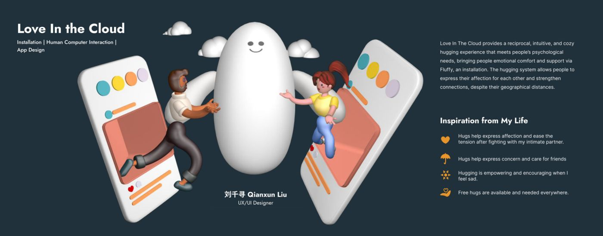
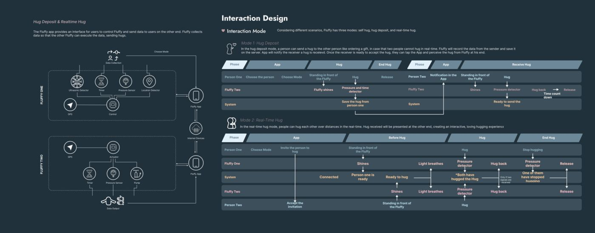
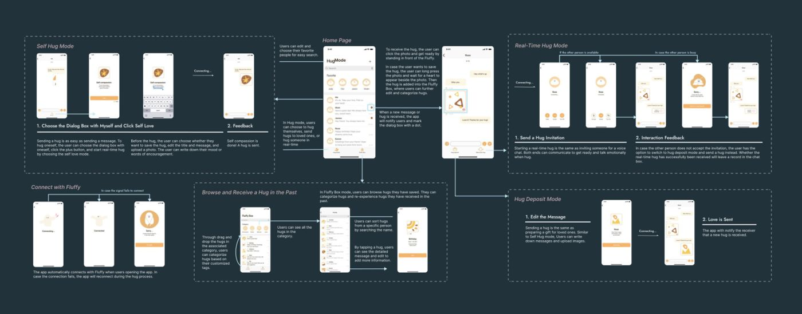
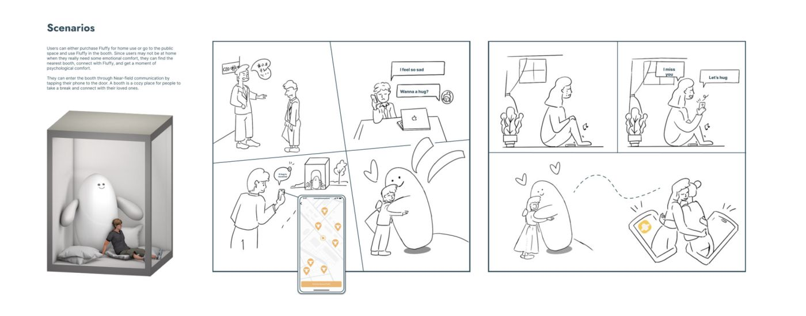

# Love in the Cloud

**刘千寻 Qianxun Liu** · UX / UI 设计实习生 · 悉尼科技大学（UTS）交互设计硕士在读

📄 **[下载完整作品集 PDF（11 页）](Love-in-the-Cloud_Portfolio.pdf)** ← 研究过程、结构测试、完整流程图和界面都在这里

## 一句话介绍

一个让**异地的人也能互相拥抱**的设计：一只充气的触觉装置 **Fluffy**，加一个用来控制它的 **App**。

2024 年申请 UTS 硕士时的个人作品集项目，在导师指导下独立完成，从研究一直做到高保真原型，还手工做了充气原型来验证结构。

## 为什么做这个

- 异地的情侣、家人、朋友可以视频、打字，但**没法拥抱**。
- 心理学研究显示，拥抱这类身体接触对情绪和心理健康很重要。
- 我拆解了市面上的同类产品，发现它们**缺少双向、实时的回应**，也没有大面积的触感。
- 所以我把方向定在：以触觉交互为核心，让两个人能真正"抱到"对方。

## 三种拥抱模式

| 模式 | 怎么用 | 类比 |
|---|---|---|
| **即时拥抱** | 双方同时抱住各自的 Fluffy，实时感受对方 | 像打语音电话 |
| **留言式拥抱** | 对方不在时，先把拥抱存起来，对方之后再收到 | 像送一份礼物 |
| **自我拥抱** | 一个人的时候，自己抱 Fluffy | 给自己一个抱抱 |

**异常情况也考虑了**：拥抱时信号断了，会自动变成"留言式拥抱"；对方没接，可以改成留言。

*交互流程：每种模式下，用户、App、Fluffy 之间的步骤和状态变化*

## App 界面

从手绘草图一步步做到 Figma 高保真原型。主要页面有首页、对话页、Fluffy Box（收藏模块），还设计了"连接中""重新连接"等反馈状态，让用户知道现在发生了什么。

## 使用场景

## 我做了哪些事

- 用户研究与竞品分析
- 设计三种拥抱模式和它们的状态流
- 制定设计原则，参考打电话、送礼物这些大家熟悉的方式，降低学习成本
- App 界面：从草图到 Figma 高保真原型
- 装置结构：手工做充气原型，测试形状和结构

> 更详细的研究资料、心理学实验设计、结构测试过程，都在 **[完整作品集 PDF](Love-in-the-Cloud_Portfolio.pdf)** 里。

## 其他作品

- 猫咪收银台（记账网页 · 个人项目）：[kitty-cash-expense-tracker](https://github.com/BrownieeOVO/kitty-cash-expense-tracker)
- Muted Keys（游戏 Demo）：[itch.io 试玩](https://brownieeovo.itch.io/muted-keys)

联系方式请见我投递时的简历。
